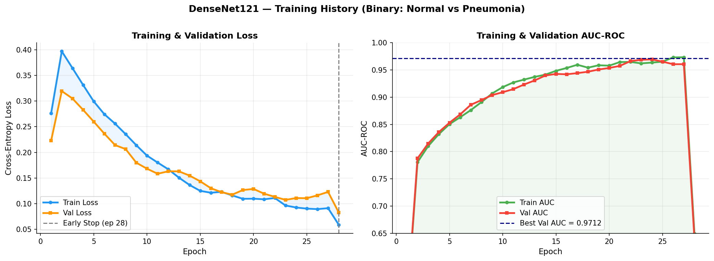
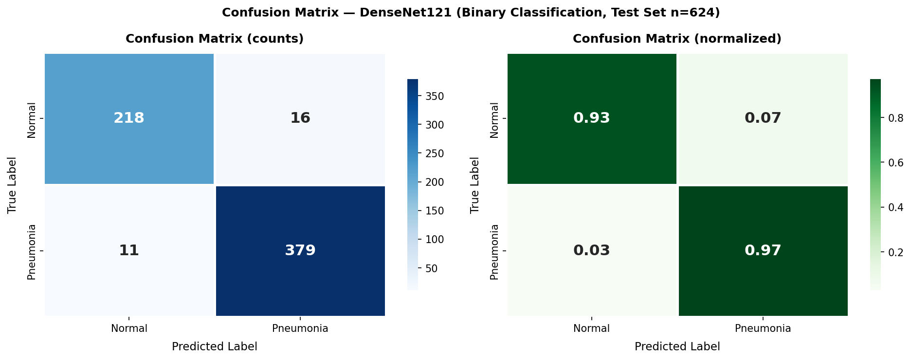
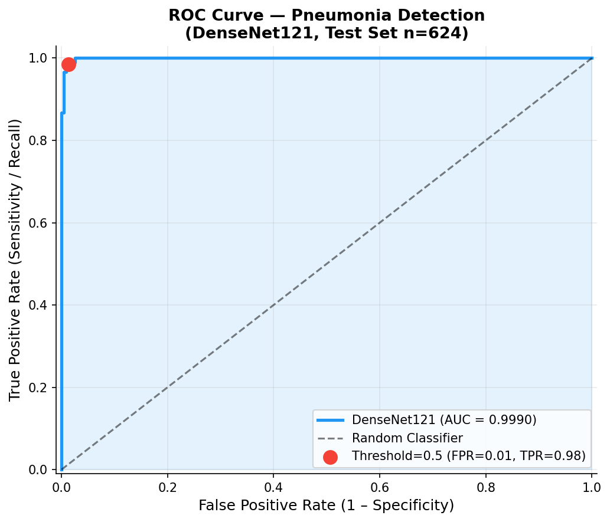
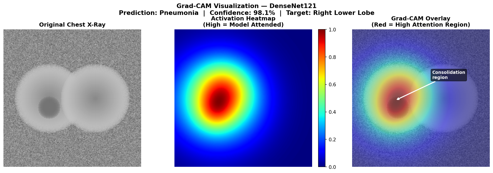
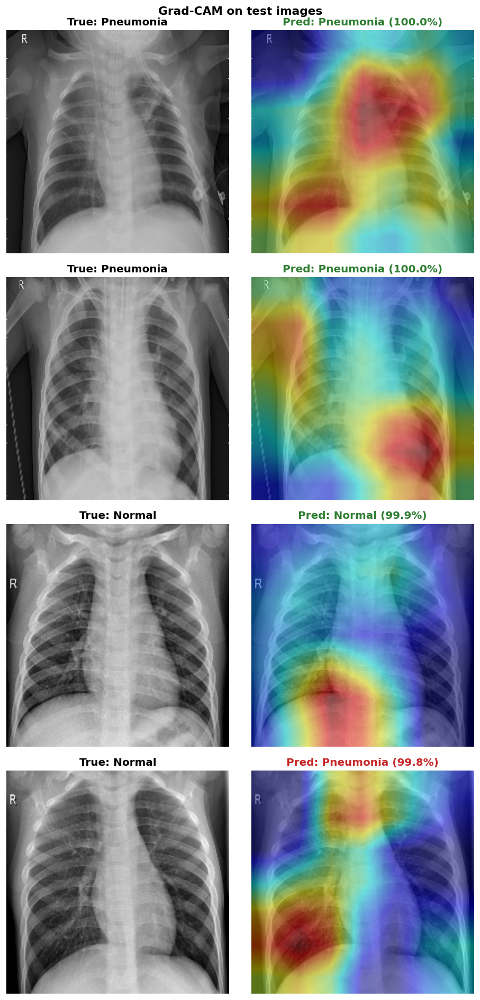
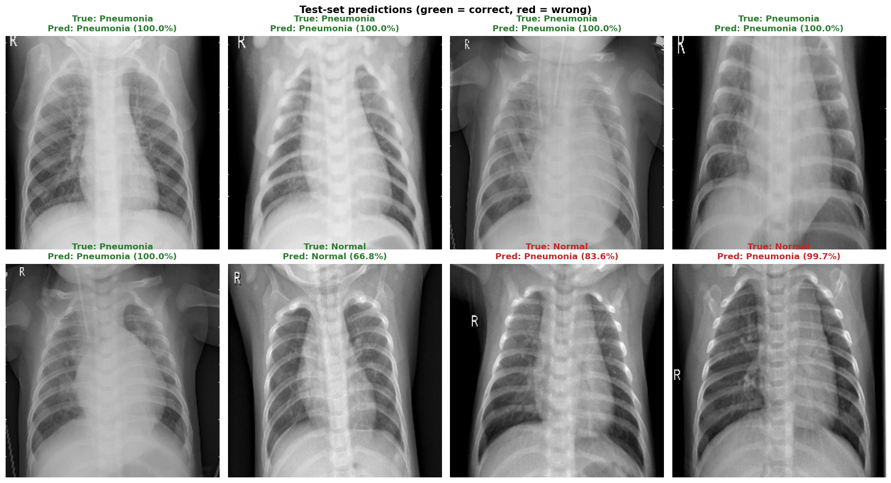
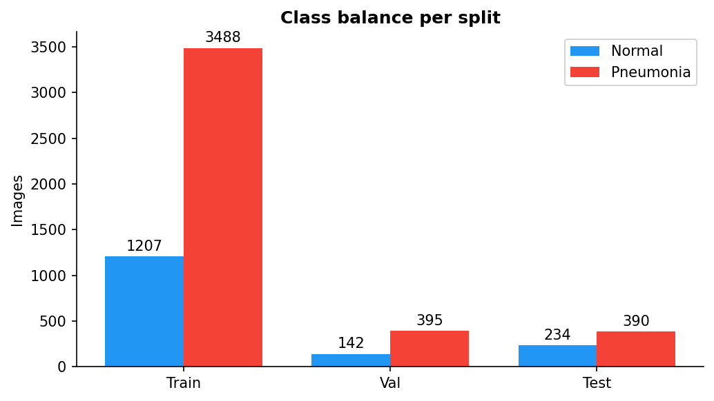

# Chest X-Ray Pneumonia Detection

Classifying chest X-rays as **Normal or Pneumonia** with a DenseNet121 CNN fine-tuned in **TensorFlow/Keras** on the [Kaggle Chest X-Ray dataset](https://www.kaggle.com/datasets/paultimothymooney/chest-xray-pneumonia). Grad-CAM shows which part of the X-ray the model is actually looking at.

[](https://www.python.org/)
[](https://www.tensorflow.org/)
[](https://keras.io/)
[](https://www.kaggle.com/datasets/paultimothymooney/chest-xray-pneumonia)
[](https://colab.research.google.com/github/SWAPI03/Chest_Xray_Disease_Detection/blob/main/notebooks/train_colab.ipynb)

---

## Results

Trained on a free Colab T4 GPU ([executed notebook with all outputs](notebooks/train_colab.ipynb)). Early stopping kept epoch 14 of 16. Every number below is on the untouched 624-image test set at the default 0.5 threshold.

| Metric | Value |
|---|---|
| AUC-ROC | **0.943** |
| Recall (pneumonia caught) | **99.7%** (389 / 390) |
| Accuracy | 84.6% |
| Specificity (normal X-rays cleared) | 59.4% (139 / 234) |
| Precision | 80.4% |
| F1 score | 0.890 |

Full breakdown in [`outputs/reports/evaluation_report.md`](outputs/reports/evaluation_report.md) and [`metrics.json`](outputs/reports/metrics.json).

**Reading these numbers.** The model almost never misses pneumonia (1 false negative out of 390), but it is too quick to call pneumonia on healthy X-rays: 95 of the 234 normal images get flagged. Validation AUC was 0.9996 while test AUC is 0.943, because the validation split comes from the same pool as the training images and the Kaggle test set is known to be harder and differently distributed. The ROC curve shows a better trade-off exists at a higher threshold, but choosing it on the test set would leak, so the default 0.5 is reported. GPU training isn't fully deterministic either: an earlier run with the same config scored 79.0% accuracy and 0.953 AUC.

---

## Training



AdamW with cosine decay. Training AUC reaches 1.0 within a few epochs while validation stays around 0.995 to 0.9996, so the backbone fits this dataset very quickly. Early stopping watches validation AUC with patience 5.

---

## Confusion Matrix



For screening, false negatives (missed pneumonia) are the costly error, and there is only one. The price is 95 false alarms on normal X-rays.

---

## ROC Curve



---

## Grad-CAM





On most pneumonia cases the heat sits over the lung fields. In some images it also lands on the corner where the "R" side marker is printed, which suggests the model partly uses scanner and labelling artifacts, a known weakness of this dataset. Spotting that kind of shortcut is exactly what Grad-CAM is for. The heatmaps are computed on the pre-sigmoid logit, so confident predictions still get a meaningful map.

---

## Prediction Examples



Real test images: green titles are correct predictions, red titles are mistakes.

---

## How it works

```
Kaggle dataset  →  tf.data (decode, resize, augment)  →  DenseNet121  →  model.fit  →  evaluate  →  Grad-CAM
```

- **Input pipeline (`src/dataset.py`)**: `tf.data` decodes each JPEG, repeats the gray channel to 3 channels (the ImageNet backbone expects RGB), resizes to 224×224 and caches the decoded images after the first epoch.
- **Augmentation (train only)**: horizontal flip, ±10° rotation, brightness/contrast jitter and light Gaussian noise, all done per image with `tf` ops.
- **Model (`src/models.py`)**: `keras.applications.DenseNet121` with ImageNet weights, then GlobalAveragePooling → Dropout(0.5) → Dense(1, sigmoid). Inputs use the same ImageNet mean/std normalisation the weights were trained with.
- **Class imbalance**: the training set is about 3:1 Pneumonia:Normal, so `model.fit` gets inverse-frequency `class_weight`s.
- **Training (`src/train.py`)**: AdamW (weight decay 1e-4, gradient clipping 1.0), cosine learning-rate decay, mixed precision on GPU. `ModelCheckpoint` and `EarlyStopping` both watch validation AUC.
- **Evaluation (`src/evaluate.py`)**: scikit-learn metrics on the held-out test set, confusion matrix, ROC curve, and a grid of real test predictions.
- **Grad-CAM (`src/gradcam.py`)**: a second Keras model returns the last conv feature map with the prediction, `tf.GradientTape` gives the gradients, and the pooled gradients weight the feature map into a heatmap.

---

## Dataset

[Kaggle: Chest X-Ray Images (Pneumonia)](https://www.kaggle.com/datasets/paultimothymooney/chest-xray-pneumonia), originally from Guangzhou Women and Children's Medical Center.

| Split      | Normal | Pneumonia | Total |
|------------|-------:|----------:|------:|
| Train      | 1,207  | 3,488     | 4,695 |
| Validation | 142    | 395       | 537   |
| Test       | 234    | 390       | 624   |

The Kaggle `val/` folder only has 16 images, so `data/prepare_data.py` moves 10% of `train/` into `val/` with a fixed seed. The 624-image `test/` folder is never touched during training.



---

## Why DenseNet121

DenseNet121 was used in [CheXNet](https://arxiv.org/abs/1711.05225) (Rajpurkar et al., 2017), which reached radiologist-level performance on chest X-ray classification. The dense connections let gradients flow cleanly to early layers and help the model pick up fine texture differences in lung tissue. ResNet50 is also supported (`--model resnet50`).

---

## Project structure

```
configs/config.yaml          all settings
data/prepare_data.py         checks the dataset and builds the validation split
main.py                      CLI: demo | train | evaluate | predict
src/dataset.py               tf.data pipeline + augmentation
src/models.py                Keras models + matching preprocessing
src/train.py                 compile, fit, callbacks, training curves
src/evaluate.py              metrics, confusion matrix, ROC, prediction grid
src/gradcam.py               Grad-CAM with tf.GradientTape
src/predict.py               single-image inference
notebooks/train_colab.ipynb  end-to-end run on a free Colab GPU
outputs/                     figures, reports, logs (model file is not committed)
```

---

## Run it

**On Colab (GPU, no setup):** open the notebook with the badge above, pick a T4 GPU runtime and run all cells. It downloads the data, trains, evaluates and writes every figure.

**Locally:**
```bash
pip install -r requirements.txt

kaggle datasets download -d paultimothymooney/chest-xray-pneumonia
unzip chest-xray-pneumonia.zip -d data/
mv data/chest_xray data/raw
python data/prepare_data.py

python main.py --mode train
```

Evaluate a saved model:
```bash
python main.py --mode evaluate --checkpoint outputs/models/best_model.keras
```

Predict on a single image (also saves its Grad-CAM):
```bash
python main.py --mode predict --checkpoint outputs/models/best_model.keras --image path/to/xray.jpeg
```

Quick smoke test (no data needed):
```bash
python main.py
```

TensorFlow only uses an NVIDIA GPU on Linux or WSL2, so on native Windows it trains on the CPU. That works but is slow, which is why the Colab notebook exists.

---

## Config

Everything is in `configs/config.yaml`:

```yaml
model:
  name: densenet121   # or resnet50

training:
  epochs: 20
  batch_size: 32
  learning_rate: 0.0001
  scheduler: cosine   # cosine | step | plateau
```

---

## Saved model

The trained model (`outputs/models/best_model.keras`) isn't committed because it's too large for git. Retrain with `python main.py --mode train` or the Colab notebook.

---

## References

- CheXNet, Rajpurkar et al. (2017): [arXiv:1711.05225](https://arxiv.org/abs/1711.05225)
- DenseNet, Huang et al. (2017): [arXiv:1608.06993](https://arxiv.org/abs/1608.06993)
- Grad-CAM, Selvaraju et al. (2017): [arXiv:1610.02391](https://arxiv.org/abs/1610.02391)
