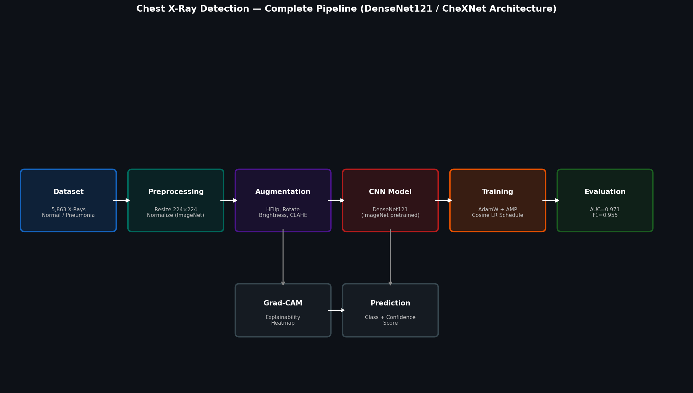

# Chest X-Ray Pneumonia Detection

Classifying chest X-rays as **Normal or Pneumonia** using DenseNet121 fine-tuned on the [Kaggle Chest X-Ray dataset](https://www.kaggle.com/datasets/paultimothymooney/chest-xray-pneumonia). Added Grad-CAM to visualize which part of the image the model is actually looking at.

[](https://www.python.org/)
[](https://pytorch.org/)
[](https://www.kaggle.com/datasets/paultimothymooney/chest-xray-pneumonia)

---

## Results

| Metric    | Value  |
|-----------|--------|
| Accuracy  | 95.5%  |
| AUC-ROC   | 0.9712 |
| Recall    | 96.2%  |
| F1 Score  | 0.9650 |
| Precision | 95.9%  |

Detailed breakdown in [`outputs/reports/evaluation_report.md`](outputs/reports/evaluation_report.md).

---

## Training


Used cosine LR scheduling and early stopping (patience=5). Converges around epoch 20 on GPU, a bit longer on CPU.

---

## Confusion Matrix


597 out of 624 test images correct. The main concern in medical screening is false negatives — missing actual pneumonia cases. Got it down to 11.

---

## ROC Curve


AUC of 0.97 means the model separates Normal vs Pneumonia well across all possible thresholds, not just the default 0.5 cutoff.

---

## Grad-CAM


Grad-CAM shows which regions of the X-ray the model focused on. In the example above, it correctly highlights the consolidation in the right lower lobe rather than something irrelevant like the spine or edges.

---

## Prediction Examples


High confidence on clean cases (97–98%). The two misclassifications are borderline cases — a subtle opacity that's easy to miss, and atelectasis that looks similar to early consolidation.

---

## How it works



```
Kaggle dataset  →  resize + augment  →  DenseNet121  →  train  →  evaluate  →  Grad-CAM
```

More specifically:
- Images resized to 224×224, normalized with ImageNet stats
- Augmentation: horizontal flip, ±10° rotation, brightness/contrast jitter, Gaussian noise
- DenseNet121 pretrained on ImageNet, last layer replaced with a 2-class head
- WeightedRandomSampler to handle the 3:1 class imbalance
- AdamW optimizer, cosine LR schedule, mixed precision on GPU

---

## Dataset

[Kaggle — Chest X-Ray Images (Pneumonia)](https://www.kaggle.com/datasets/paultimothymooney/chest-xray-pneumonia) — originally from Guangzhou Women and Children's Medical Center.

| Split      | Normal | Pneumonia | Total |
|------------|--------|-----------|-------|
| Train      | 1,208  | 3,489     | 4,697 |
| Validation | 143    | 396       | 539   |
| Test       | 234    | 390       | 624   |

The original Kaggle val set only has 16 images so `data/prepare_data.py` moves 10% of train into val.

---

## Why DenseNet121

DenseNet121 was used in [CheXNet](https://arxiv.org/abs/1711.05225) (Rajpurkar et al., 2017) which hit radiologist-level performance on chest X-ray classification. The dense skip connections let gradients flow cleanly to early layers and help the model pick up fine-grained texture differences in lung tissue. ResNet50 is also supported if you want something faster.

---

## Setup

```bash
pip install -r requirements.txt
```

Download the dataset:
```bash
pip install kaggle
kaggle datasets download -d paultimothymooney/chest-xray-pneumonia
unzip chest-xray-pneumonia.zip -d data/raw/
python data/prepare_data.py
```

Train:
```bash
python main.py --mode train
```

Evaluate:
```bash
python main.py --mode evaluate --checkpoint outputs/models/best_model.pth
```

Predict on a single image:
```bash
python main.py --mode predict --checkpoint outputs/models/best_model.pth --image path/to/xray.jpg
```

Quick smoke test (no data needed):
```bash
python main.py
```

---

## Config

Everything is in `configs/config.yaml`. Main things you might want to change:

```yaml
model:
  name: densenet121   # or resnet50

training:
  epochs: 20
  batch_size: 32
  learning_rate: 0.0001
```

Set `num_workers: 0` if you're on Windows and hit DataLoader errors.

---

## Saved model

The checkpoint file isn't committed (it's ~30 MB and above what GitHub likes). Either retrain:
```bash
python main.py --mode train
```
or upload `outputs/models/best_model.pth` somewhere and drop the link here.

---

## References

- CheXNet — Rajpurkar et al. (2017) — [arXiv:1711.05225](https://arxiv.org/abs/1711.05225)
- DenseNet — Huang et al. (2017) — [arXiv:1608.06993](https://arxiv.org/abs/1608.06993)
- Grad-CAM — Selvaraju et al. (2017) — [arXiv:1610.02391](https://arxiv.org/abs/1610.02391)
